# LAB 12 — Enterprise Azure Storage: Azure Portal Capability Tests

> **Training-only simulations.** All 14 images are illustrative UI mockups, not screenshots from a real Azure subscription. Their values are examples and do not prove that tests have passed.

## Preparation

Use a disposable lab resource group, a general-purpose v2 storage account, and a dedicated test identity. Record the real resource names, region, subscription restrictions, date, screenshots, expected outcome, actual outcome, and cleanup evidence. Do not paste account keys, SAS tokens, or secrets into screenshots.

## Capability walkthroughs

### 01. Storage account security

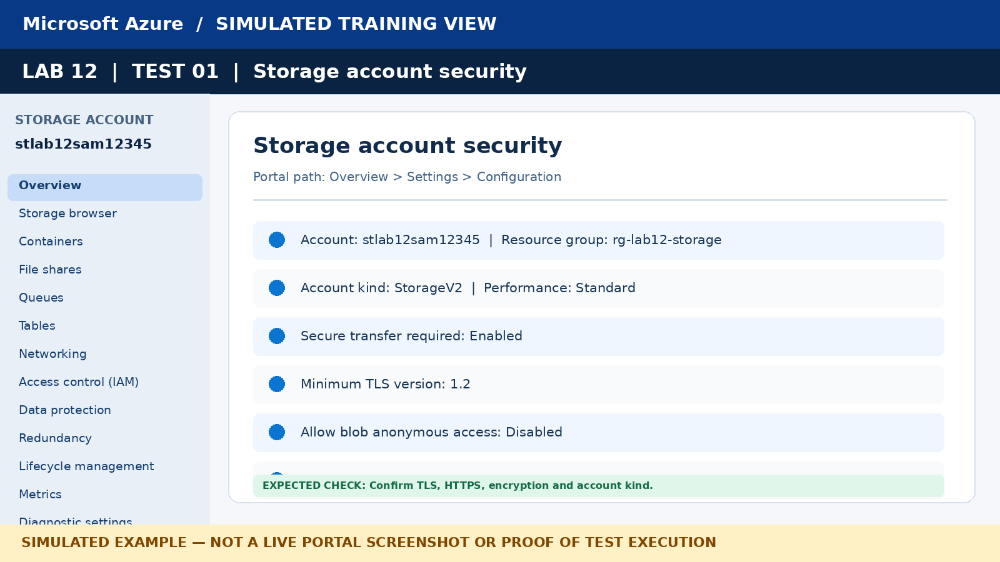

**Portal navigation:** `Overview > Settings > Configuration`.

**Suggested procedure:** Account: stlab12sam12345  |  Resource group: rg-lab12-storage → Account kind: StorageV2  |  Performance: Standard → Secure transfer required: Enabled → Minimum TLS version: 1.2 → Allow blob anonymous access: Disabled → Encryption at rest: Microsoft-managed keys.

**Pass criterion:** Confirm TLS, HTTPS, encryption and account kind.

**Student evidence:** Capture the corresponding real Portal blade and the successful/denied operation as appropriate.

### 02. Blob containers and object operations

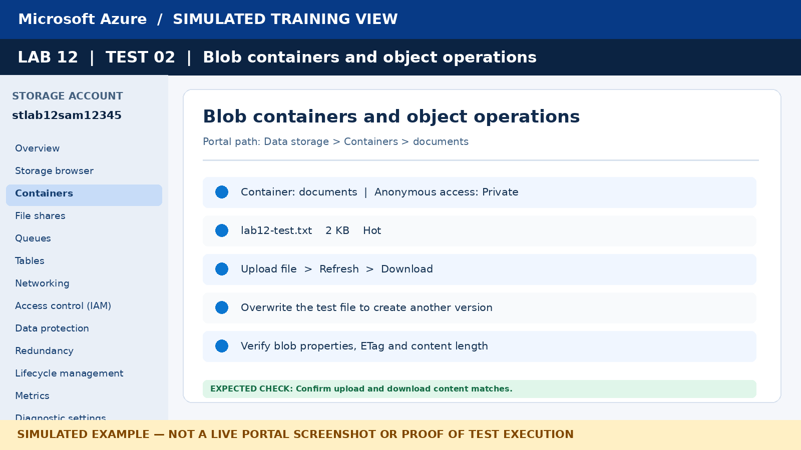

**Portal navigation:** `Data storage > Containers > documents`.

**Suggested procedure:** Container: documents  |  Anonymous access: Private → lab12-test.txt    2 KB    Hot → Upload file  >  Refresh  >  Download → Overwrite the test file to create another version → Verify blob properties, ETag and content length.

**Pass criterion:** Confirm upload and download content matches.

**Student evidence:** Capture the corresponding real Portal blade and the successful/denied operation as appropriate.

### 03. Blob versioning and soft delete

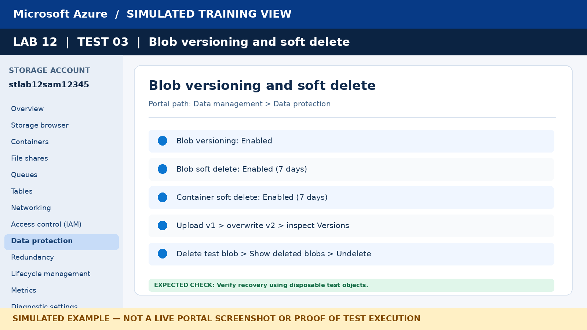

**Portal navigation:** `Data management > Data protection`.

**Suggested procedure:** Blob versioning: Enabled → Blob soft delete: Enabled (7 days) → Container soft delete: Enabled (7 days) → Upload v1 > overwrite v2 > inspect Versions → Delete test blob > Show deleted blobs > Undelete.

**Pass criterion:** Verify recovery using disposable test objects.

**Student evidence:** Capture the corresponding real Portal blade and the successful/denied operation as appropriate.

### 04. Azure Files share and snapshots

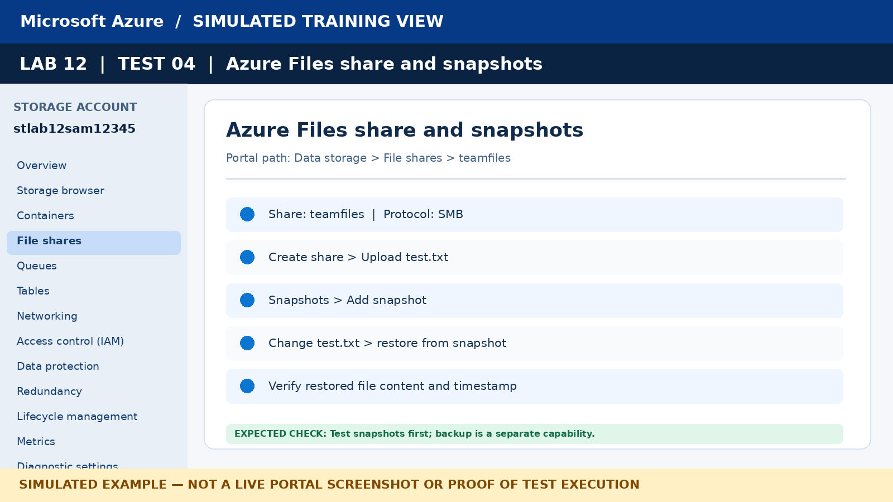

**Portal navigation:** `Data storage > File shares > teamfiles`.

**Suggested procedure:** Share: teamfiles  |  Protocol: SMB → Create share > Upload test.txt → Snapshots > Add snapshot → Change test.txt > restore from snapshot → Verify restored file content and timestamp.

**Pass criterion:** Test snapshots first; backup is a separate capability.

**Student evidence:** Capture the corresponding real Portal blade and the successful/denied operation as appropriate.

### 05. SAS delegated access

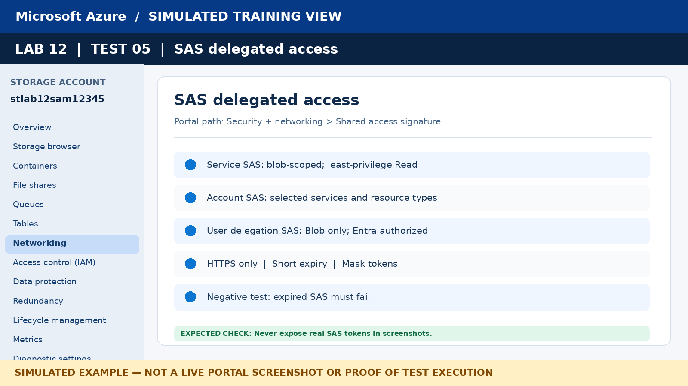

**Portal navigation:** `Security + networking > Shared access signature`.

**Suggested procedure:** Service SAS: blob-scoped; least-privilege Read → Account SAS: selected services and resource types → User delegation SAS: Blob only; Entra authorized → HTTPS only  |  Short expiry  |  Mask tokens → Negative test: expired SAS must fail.

**Pass criterion:** Never expose real SAS tokens in screenshots.

**Student evidence:** Capture the corresponding real Portal blade and the successful/denied operation as appropriate.

### 06. Blob lifecycle automation

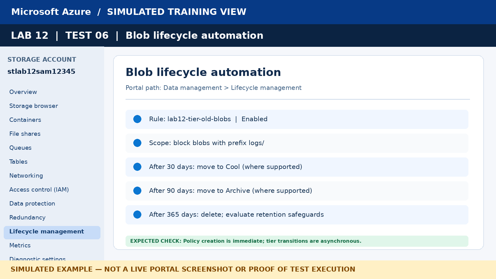

**Portal navigation:** `Data management > Lifecycle management`.

**Suggested procedure:** Rule: lab12-tier-old-blobs  |  Enabled → Scope: block blobs with prefix logs/ → After 30 days: move to Cool (where supported) → After 90 days: move to Archive (where supported) → After 365 days: delete; evaluate retention safeguards.

**Pass criterion:** Policy creation is immediate; tier transitions are asynchronous.

**Student evidence:** Capture the corresponding real Portal blade and the successful/denied operation as appropriate.

### 07. Azure Queue Storage

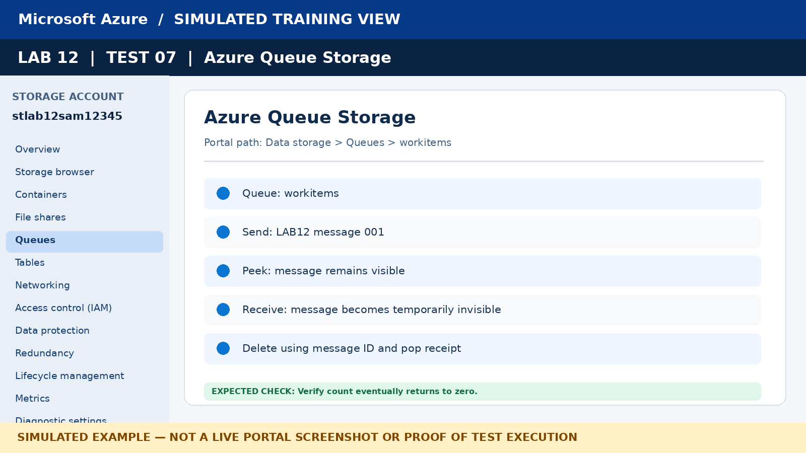

**Portal navigation:** `Data storage > Queues > workitems`.

**Suggested procedure:** Queue: workitems → Send: LAB12 message 001 → Peek: message remains visible → Receive: message becomes temporarily invisible → Delete using message ID and pop receipt.

**Pass criterion:** Verify count eventually returns to zero.

**Student evidence:** Capture the corresponding real Portal blade and the successful/denied operation as appropriate.

### 08. Azure Table Storage

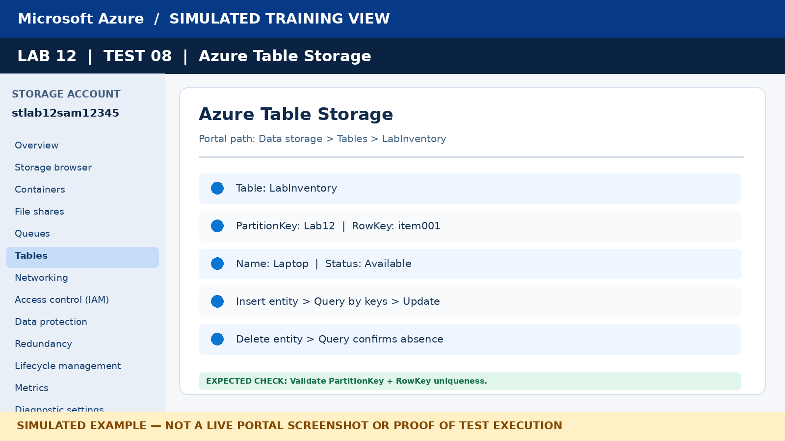

**Portal navigation:** `Data storage > Tables > LabInventory`.

**Suggested procedure:** Table: LabInventory → PartitionKey: Lab12  |  RowKey: item001 → Name: Laptop  |  Status: Available → Insert entity > Query by keys > Update → Delete entity > Query confirms absence.

**Pass criterion:** Validate PartitionKey + RowKey uniqueness.

**Student evidence:** Capture the corresponding real Portal blade and the successful/denied operation as appropriate.

### 09. Azure Managed Disks

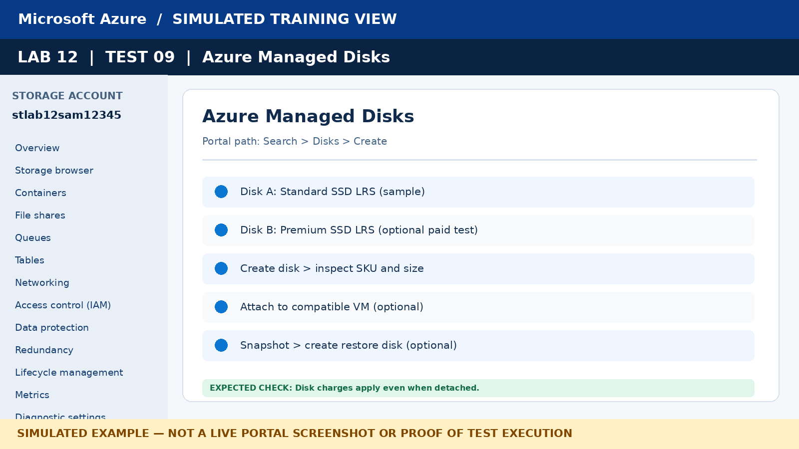

**Portal navigation:** `Search > Disks > Create`.

**Suggested procedure:** Disk A: Standard SSD LRS (sample) → Disk B: Premium SSD LRS (optional paid test) → Create disk > inspect SKU and size → Attach to compatible VM (optional) → Snapshot > create restore disk (optional).

**Pass criterion:** Disk charges apply even when detached.

**Student evidence:** Capture the corresponding real Portal blade and the successful/denied operation as appropriate.

### 10. Storage firewall and private endpoints

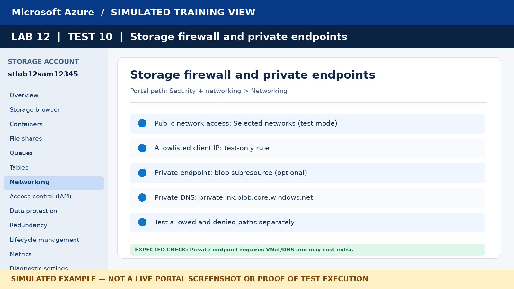

**Portal navigation:** `Security + networking > Networking`.

**Suggested procedure:** Public network access: Selected networks (test mode) → Allowlisted client IP: test-only rule → Private endpoint: blob subresource (optional) → Private DNS: privatelink.blob.core.windows.net → Test allowed and denied paths separately.

**Pass criterion:** Private endpoint requires VNet/DNS and may cost extra.

**Student evidence:** Capture the corresponding real Portal blade and the successful/denied operation as appropriate.

### 11. Identity and data-plane RBAC

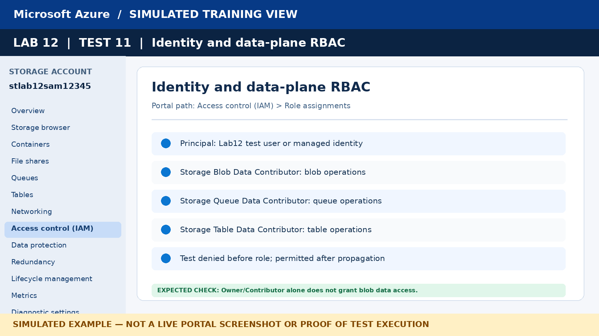

**Portal navigation:** `Access control (IAM) > Role assignments`.

**Suggested procedure:** Principal: Lab12 test user or managed identity → Storage Blob Data Contributor: blob operations → Storage Queue Data Contributor: queue operations → Storage Table Data Contributor: table operations → Test denied before role; permitted after propagation.

**Pass criterion:** Owner/Contributor alone does not grant blob data access.

**Student evidence:** Capture the corresponding real Portal blade and the successful/denied operation as appropriate.

### 12. Storage redundancy comparison

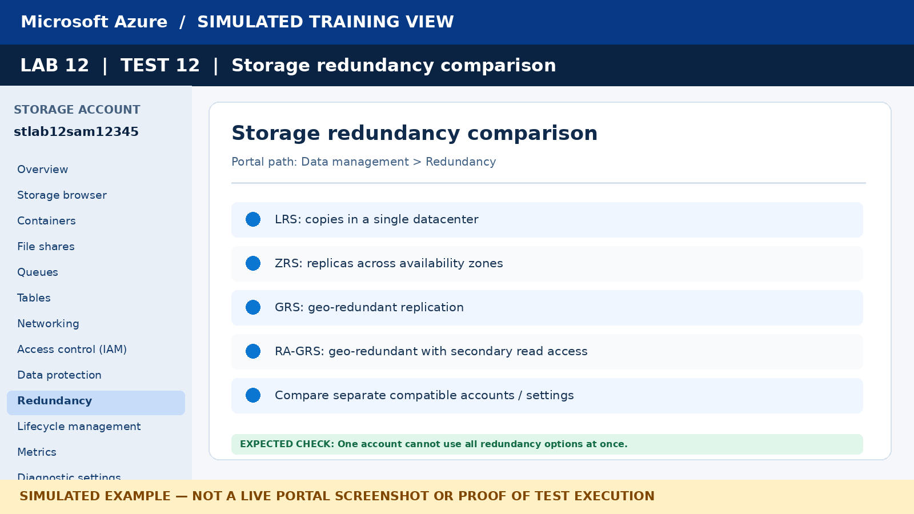

**Portal navigation:** `Data management > Redundancy`.

**Suggested procedure:** LRS: copies in a single datacenter → ZRS: replicas across availability zones → GRS: geo-redundant replication → RA-GRS: geo-redundant with secondary read access → Compare separate compatible accounts / settings.

**Pass criterion:** One account cannot use all redundancy options at once.

**Student evidence:** Capture the corresponding real Portal blade and the successful/denied operation as appropriate.

### 13. Immutable blob retention

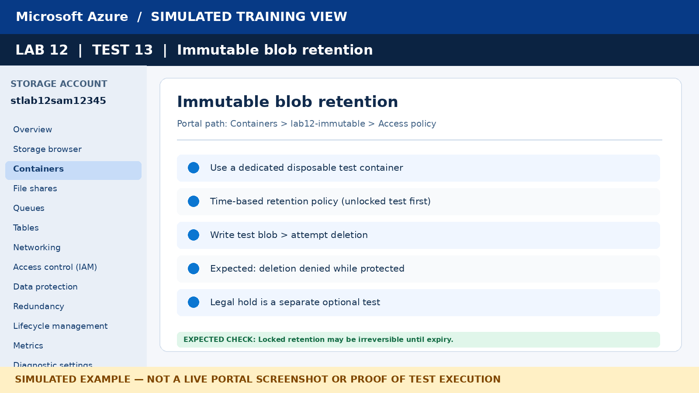

**Portal navigation:** `Containers > lab12-immutable > Access policy`.

**Suggested procedure:** Use a dedicated disposable test container → Time-based retention policy (unlocked test first) → Write test blob > attempt deletion → Expected: deletion denied while protected → Legal hold is a separate optional test.

**Pass criterion:** Locked retention may be irreversible until expiry.

**Student evidence:** Capture the corresponding real Portal blade and the successful/denied operation as appropriate.

### 14. Metrics, logs and alerts

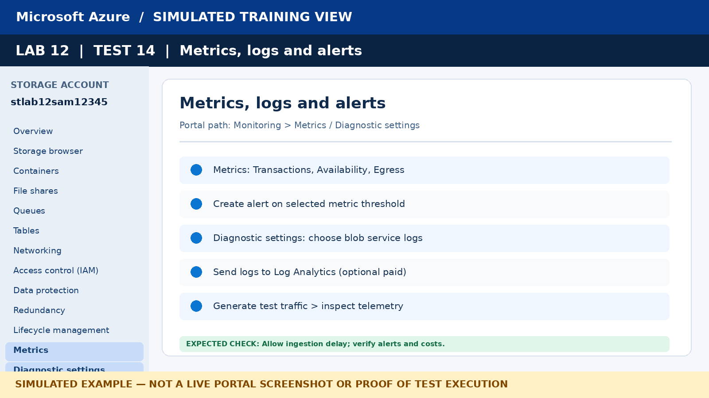

**Portal navigation:** `Monitoring > Metrics / Diagnostic settings`.

**Suggested procedure:** Metrics: Transactions, Availability, Egress → Create alert on selected metric threshold → Diagnostic settings: choose blob service logs → Send logs to Log Analytics (optional paid) → Generate test traffic > inspect telemetry.

**Pass criterion:** Allow ingestion delay; verify alerts and costs.

**Student evidence:** Capture the corresponding real Portal blade and the successful/denied operation as appropriate.

## Important implementation notes

- **Redundancy:** LRS, ZRS, GRS and RA-GRS are alternatives; compare supported choices across separate accounts or change settings where allowed. Availability varies by region and account type.
- **Access tiers:** Hot, Cool and Archive have different availability, minimum retention and retrieval costs; archived blobs cannot be read until rehydrated. Lifecycle processing is not instantaneous.
- **SAS:** User delegation SAS applies to Blob Storage, not Azure Files/Queue/Table. Prefer Microsoft Entra authorization, HTTPS, short expiry and minimum permissions.
- **Azure Files:** SMB and NFS have different account/share and networking prerequisites. Directory integration requires additional setup; a share snapshot is not a substitute for a configured backup strategy.
- **Managed disks:** These are separate Azure resources, not a blade inside a StorageV2 account. Premium disks, VMs and snapshots may incur charges.
- **Private endpoints:** Require appropriate networking, DNS resolution and access from an allowed network. A public client may lose access after firewall changes.
- **Immutability:** Avoid locking a retention policy in a teaching account unless the retention consequences are understood.
- **Monitoring:** Diagnostic settings and Log Analytics may incur ingestion/retention charges. Metrics and logs may be delayed.
- **Identity:** Storage data-plane roles are distinct from Azure resource management roles. Allow time for RBAC propagation.

## Results log template

| Test | Expected | Actual | Pass/Fail | Evidence file |
|---|---|---|---|---|
| 01 Storage account security | As described above | | | |
| 02 Blob containers and object operations | As described above | | | |
| 03 Blob versioning and soft delete | As described above | | | |
| 04 Azure Files share and snapshots | As described above | | | |
| 05 SAS delegated access | As described above | | | |
| 06 Blob lifecycle automation | As described above | | | |
| 07 Azure Queue Storage | As described above | | | |
| 08 Azure Table Storage | As described above | | | |
| 09 Azure Managed Disks | As described above | | | |
| 10 Storage firewall and private endpoints | As described above | | | |
| 11 Identity and data-plane RBAC | As described above | | | |
| 12 Storage redundancy comparison | As described above | | | |
| 13 Immutable blob retention | As described above | | | |
| 14 Metrics, logs and alerts | As described above | | | |

## Cleanup

Delete test messages, entities, files, blobs, snapshots, disks, private endpoints and optional analytics resources when safe. Review retention locks and soft-delete policies before attempting to delete the resource group. Confirm Azure Cost Management after the lab.
